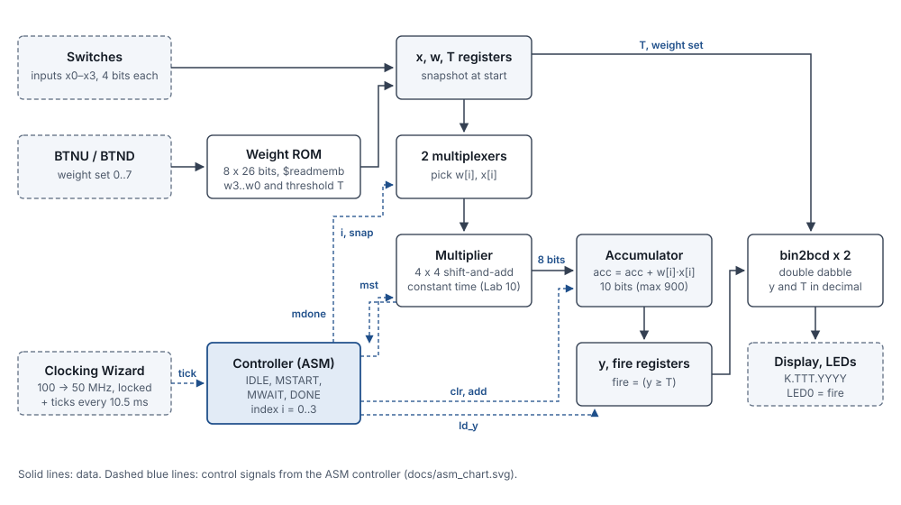
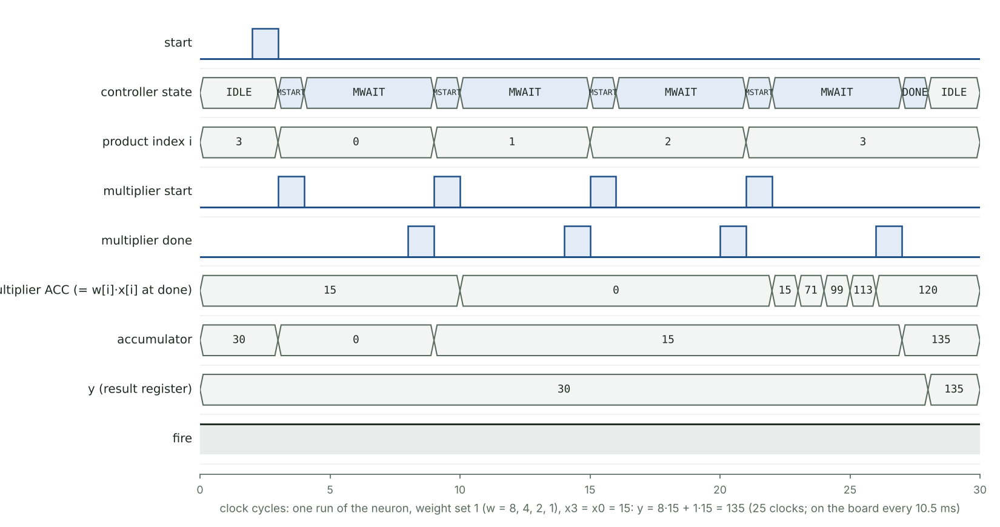

# MAC Neuron Accelerator on an FPGA

**Programmable Logic Devices course project** · University of Debrecen, Faculty of Informatics · Verilog · Xilinx Vivado · Digilent Nexys 4 DDR (Artix-7 XC7A100T)

One artificial neuron, built in hardware:

```
y = w0·x0 + w1·x1 + w2·x2 + w3·x3        fire = (y ≥ T)
```

- The four inputs come from the switches.
- The four weights and the threshold T come from a ROM that holds 8 weight sets.
- An **ASM-chart controller** runs a **shift-and-add multiplier** four times and adds up the products in an accumulator. This is the controller-plus-datapath design of the course's Lab 10, and the multiply-accumulate (MAC) operation at the core of every AI accelerator.

The design also shows a **timing side channel**. The course's multiplier takes longer when the multiplier has more 1 bits, so its run time leaks information about the data. This design uses a constant-time version, and the testbench proves the difference.

- [x] Verified in simulation: 3 self-checking testbenches, all pass
- [ ] Tested on the Nexys 4 DDR board



## Running it on the board

| Board part | Use |
| --- | --- |
| SW3–SW0 | input x0 (0–15) |
| SW7–SW4 | input x1 |
| SW11–SW8 | input x2 |
| SW15–SW12 | input x3 |
| BTNU / BTND | next / previous weight set (0–7) |
| CPU RESET | reset |
| Display | `K.TTT.YYYY`: weight set, threshold, neuron output y |
| LED0 | fire: y ≥ threshold |
| LED3–LED1 | weight set in binary |
| LED13–LED4 | y in binary |
| LED14 | heartbeat |
| LED15 | clock locked (Clocking Wizard) |

A new result is computed every 10.5 ms, so the display follows the switches as you move them.

Demo:

1. Press CPU RESET. The display shows set 0: `0.030.0000` with all switches off.
2. Switch on SW3–SW0 and SW15–SW12 (x0 = x3 = 15). Set 0 adds the inputs, so y = 30 = the threshold. The display shows `0.030.0030` and LED0 lights.
3. Press BTNU for set 1, weights 8, 4, 2, 1: y = 8·15 + 1·15 = 135, `1.100.0135`, LED0 on.
4. Press BTNU twice for set 3 and switch everything on: y = 4·15·15 = 900, the largest possible, `3.450.0900`.

| Set | Weights w3, w2, w1, w0 | Threshold | What it does |
| --- | --- | --- | --- |
| 0 | 1, 1, 1, 1 | 30 | sum of the inputs |
| 1 | 8, 4, 2, 1 | 100 | x3 matters most |
| 2 | 1, 2, 4, 8 | 100 | x0 matters most |
| 3 | 15, 15, 15, 15 | 450 | largest weights |
| 4 | 0, 0, 0, 1 | 8 | only x0 counts |
| 5 | 3, 0, 0, 3 | 45 | the two outer inputs |
| 6 | 5, 5, 0, 0 | 50 | the two upper inputs |
| 7 | 0, 0, 0, 0 | 1 | a "dead" neuron that never fires |

The weights live in `src/weights.mem`. Edit that file and rebuild to give the neuron new weights, without touching the Verilog.

## Design

A full walkthrough of every module, the ASM chart, the timing side channel and the verification plan is in [docs/PROJECT_GUIDE.md](docs/PROJECT_GUIDE.md).

### Modules and the course topics behind them

| Module | What it does | PLD course topic |
| --- | --- | --- |
| `seq_mult_lab.v` | shift-and-add multiplier exactly as in the lecture's SM chart, N bits | Lecture 9, Lab 10 |
| `seq_mult.v` | the same multiplier, constant-time: add and shift in one clock | Lab 10 |
| `neuron.v` | ASM controller + datapath: registers, multiplexers, accumulator | Lab 10 (ASM charts), Lab 9 (FSMs) |
| `weight_rom.v`, `weights.mem` | 8 weight sets, loaded with `$readmemb` | Lab 5 (memories) |
| `bin2bcd.v` | binary → decimal digits, double dabble, function with a `for` loop | Lab 4 (number systems), Labs 6–7 |
| `clk_gen.v` | 50 MHz system clock from the Clocking Wizard IP | Lab 8 (IP catalog) |
| `ticks.v` | enable ticks for the display, buttons and new runs | Lab 8 (pulse generator) |
| `display8.v`, `hex7seg.v` | scans the 8-digit display: decoder + multiplexer | Lab 3 (decoders) |
| `btn_pulse.v` | button synchronizer, debouncer, edge detector | Digital Design project |
| `neuron_top.v` | connects everything to the board pins | top module |

### Controller: ASM chart


The chart follows the lecture's notation:
- **State boxes** carry the Moore outputs: `idle`, `mst` (start the multiplier) and `ld_y` (load the result).
- **Conditional output boxes** carry the Mealy outputs, which also depend on an input: `snap`, `clr`, `add` and `inc`.

Each decision box becomes one `if` in `neuron.v`, as Lab 10 describes.

### Timing side channel

The lecture's multiplier spends two clocks on every 1 bit of the multiplier (add, then shift) and one clock on every 0 bit (shift only). `tb_mult.v` measures every input pair:

| 1 bits in the multiplier | Course multiplier | Constant-time multiplier |
| --- | --- | --- |
| 0 | 5 clocks | 5 clocks |
| 1 | 6 clocks | 5 clocks |
| 2 | 7 clocks | 5 clocks |
| 3 | 8 clocks | 5 clocks |
| 4 | 9 clocks | 5 clocks |

Someone who can time the course version learns how many 1 bits the secret operand has. Timing attacks on cryptographic hardware work the same way. The constant-time version uses the adder on every clock and adds 0 when the bit is 0, so every multiplication takes 5 clocks, and every neuron run takes 25.

### One clock for the whole design

The Clocking Wizard turns the 100 MHz oscillator into a 50 MHz system clock. Every flip-flop runs on that one clock; slow events are one-clock enable ticks rather than divided clocks. The design is held in reset until the wizard reports `locked`. The switches and buttons pass through two-flip-flop synchronizers, and the buttons are also debounced.

## Verification

| Testbench | What it checks | Result |
| --- | --- | --- |
| `tb_mult.v` | Course multiplier, N = 3: all 64 pairs, including the Lab 10 sample waveform. Both multipliers, N = 4: all 256 pairs each against `*`, and the clocks each one takes | 579 checks, 0 errors; constant-time version 5 clocks for every pair |
| `tb_neuron.v` | All 8 weight sets × (4 corner cases + 500 random inputs) against a reference model that reads `weights.mem` itself and uses `*`. The switches change in the middle of every run, which must not matter | 4,032 runs, 0 errors, 25 clocks for every run |
| `tb_top.v` | The whole board design used like a person would: switches, bouncing buttons, weight sets wrapping 7 ↔ 0, results read from the LEDs and by decoding the scanning 7-segment display | 13 checks, 0 errors |

The testbenches use tasks for repeated stimulus (Lab 6). Expected values are computed with ordinary arithmetic, never with the design's own shift-and-add method, so a mistake cannot hide in its own test. Open-source synthesis (Yosys) finds no latches and 150 flip-flops.



*One run with weight set 1 and x3 = x0 = 15, from the system simulation. Each loop starts the multiplier (MSTART), waits for it (MWAIT), and adds the product. The multiplier row shows its accumulator shifting during each multiplication: 15, 71, 99, 113 and finally 120 = 8 × 15.*

## Build and run

**Vivado** (as in the labs)

1. Create a project for part `xc7a100tcsg324-1` (Nexys 4 DDR).
2. Add every file in `src/`, including `weights.mem`, as design sources. Add `constraints/nexys4ddr.xdc` as a constraint.
3. Add the Clocking Wizard (Lab 8): **IP Catalog → FPGA Features and Design → Clocking → Clocking Wizard**.
   - Keep the component name `clk_wiz_0`.
   - On **Output Clocks**, set clk_out1 to **50.000 MHz**.
   - Keep the default port names (`clk_in1`, `clk_out1`, `reset`, `locked`) and the active-high reset.
   - Click OK, then Generate.
4. Set `neuron_top` as the top module, run **Generate Bitstream** and program the board.

To simulate in XSim:
- Add a file from `sim/` as a simulation source.
- For `tb_top.v`, add `SIMULATION` under **Settings → Simulation → Verilog options → Defines**, so the clock passes straight through.
- `tb_mult.v` and `tb_neuron.v` need no define.

**Icarus Verilog** (free, any OS): `cd sim && ./run_sim.sh` runs all three testbenches.

## Repository layout

```
src/           Verilog design, 11 modules, and weights.mem
sim/           testbenches and run_sim.sh
constraints/   nexys4ddr.xdc (Vivado)
docs/          project guide, block diagram, ASM chart, waveform
```

## Ideas to extend it

- Signed weights (two's complement), so a neuron can also be inhibited by an input.
- A second neuron layer: two hidden neurons feeding one output neuron.
- Compare with the Artix-7's DSP48 hardware multiplier: speed and resources.
- Load the weights over UART from a PC instead of rebuilding.

---
Beshoy Hanna · Computer Science Engineering, University of Debrecen · Digital Design project: [tablet-bottling-fpga](https://github.com/HannaBeshoy/tablet-bottling-fpga)
