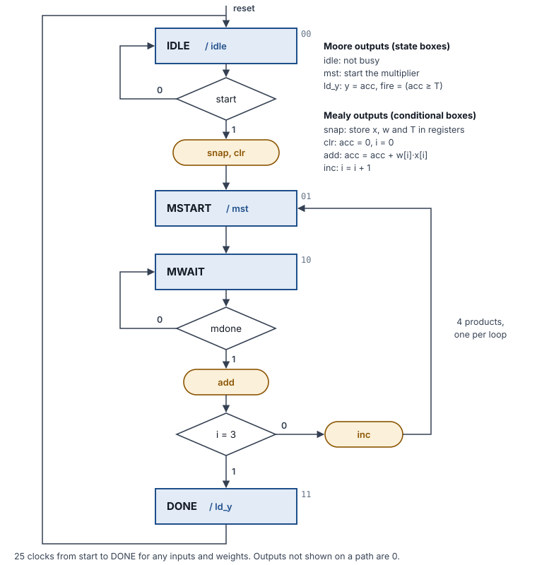

# Project guide: MAC Neuron Accelerator

This guide explains how the design works, why it is built this way and how it was verified. The [README](../README.md) covers how to run it.

## 1. The idea

A neuron in an artificial neural network multiplies each input by a weight, adds the products, and "fires" when the sum passes a threshold:

```
y = w0·x0 + w1·x1 + w2·x2 + w3·x3        fire = (y ≥ T)
```

The repeated step, `acc = acc + w·x`, is a **multiply-accumulate (MAC)**. AI accelerators are, at heart, large arrays of MAC units. This project builds one MAC unit with the tools of the Programmable Logic Devices course:

- a **shift-and-add multiplier** (Lecture 9, Lab 10);
- a **controller** designed with an **ASM chart** (Lab 10);
- a **ROM** of weights loaded with `$readmemb` (Lab 5);
- the **Clocking Wizard** IP (Lab 8);
- testbenches built from **tasks** (Lab 6).

The numbers are small on purpose: 4-bit inputs and weights (like a 4-bit quantized network), 4 inputs and a 10-bit result. Every idea scales to wider numbers and more inputs by changing parameters.

## 2. Signal flow, module by module

| Order | Module | What it does |
| --- | --- | --- |
| 1 | `clk_gen.v` | Clocking Wizard: 100 MHz → 50 MHz, plus `locked` |
| 2 | `ticks.v` | free-running counter → display digit select, a tick every 10.5 ms, heartbeat |
| 3 | `btn_pulse.v` | BTNU and BTND: synchronize, debounce, one pulse per press |
| 4 | `weight_rom.v` | weight set `sel` → w3..w0 and threshold T |
| 5 | `neuron.v` | ASM controller + datapath, uses `seq_mult.v` |
| 6 | `seq_mult.v` | constant-time 4 × 4 shift-and-add multiplier |
| 7 | `bin2bcd.v` | y and T → decimal digits |
| 8 | `display8.v`, `hex7seg.v` | scan the 8 digits: `K.TTT.YYYY` |
| 9 | `neuron_top.v` | pins, reset, switch synchronizers, LEDs |
| — | `seq_mult_lab.v` | the course's multiplier, kept for comparison (not in the board design) |

**seq_mult_lab.v** is the lecture's SM chart, line for line, made N bits wide.
- The accumulator `acc` has 2N + 1 bits. **Load** puts the multiplier into the low N bits and clears the rest.
- **Ad** adds the multiplicand to the upper half; the carry goes into the top bit. **Sh** shifts everything right.
- `M` is the low bit of `acc`, the multiplier bit under test. `K` marks the last shift.
- After N shifts, the low 2N bits hold the product.

**seq_mult.v** keeps that datapath but merges the add and the shift into one clock:

```verilog
wire [N:0] sum = acc[2*N-1:N] + (m ? mcand : 0);   // add, or add 0
acc <= {1'b0, sum, acc[N-1:1]};                     // and shift, same clock
```

The adder now works on every clock, whatever the bit. That makes the time constant.

**neuron.v** is the controller and the datapath:
- **Registers** `xr`, `wr`, `thr` take a snapshot of the switches, weights and threshold when a run starts. Moving a switch in the middle of a run cannot mix two different inputs.
- **Two multiplexers** pick the i-th 4-bit field: `wr[4*i +: 4]` and `xr[4*i +: 4]`.
- **The accumulator** `acc` is 10 bits wide, enough for the largest sum, 4 × 15 × 15 = 900.
- **The result registers** `y` and `fire` change only in DONE, so the display never shows a half-finished sum.

**bin2bcd.v** uses the *double dabble* algorithm.
- The binary number is shifted in one bit at a time.
- Before each shift, every decimal digit that is 5 or more gets 3 added, so the doubling carries correctly into the next digit.
- It is written as a Verilog function with a `for` loop. Synthesis unrolls the loop into rows of small adders: combinational logic, no clock.

**ticks.v** is the Lab 8 pulse generator with a power-of-two period. The tick is "the low 19 bits are all zero", one clock every 2^19 clocks.

**neuron_top.v** connects the board:
- Each 10.5 ms tick starts a run, but only when the neuron is idle: `start = sample_tick & ~busy`.
- The design is held in reset until the Clocking Wizard reports `locked`.

## 3. The ASM chart



| State | Code | Moore output | Decision | Mealy outputs on the path |
| --- | --- | --- | --- | --- |
| IDLE | 00 | `idle` | `start` | `snap`, `clr` when start = 1 |
| MSTART | 01 | `mst` | — | — |
| MWAIT | 10 | — | `mdone`, then `i = 3` | `add` when mdone = 1; `inc` when i ≠ 3 |
| DONE | 11 | `ld_y` | — | — |

How it becomes Verilog, as in Lab 10:
- One `always @(*)` block holds a `case` on the state.
- Each decision box is an `if`.
- Each conditional output box sets its signal to 1 inside that `if`.
- All outputs default to 0 at the top of the block, which matches the chart rule that an output not on a path is 0, and prevents latches.

The neuron's controller and the multiplier's controller are two state machines that **handshake**. The neuron raises `mst` for one clock; the multiplier answers with `mdone` for one clock. Large designs are built the same way: a controller per block, with start/done handshakes between them.

## 4. The timing side channel

`tb_mult.v` times both multipliers on all 256 input pairs (N = 4):

| 1 bits in the multiplier | Course multiplier | Constant-time multiplier |
| --- | --- | --- |
| 0 | 5 clocks | 5 clocks |
| 1 | 6 clocks | 5 clocks |
| 2 | 7 clocks | 5 clocks |
| 3 | 8 clocks | 5 clocks |
| 4 | 9 clocks | 5 clocks |

The course version spends an extra clock on every 1 bit, so its run time reveals the multiplier's number of 1 bits (its *Hamming weight*). That is a **timing side channel**.
- If the multiplier were a secret key, someone who can measure time could learn about it without reading it.
- Real attacks on RSA and on some AES implementations worked like this.
- The defense is the same as here: do the same work on every path. Here that means always adding, but adding 0 when the bit is 0.

The constant-time version is also faster in the worst case: 5 clocks instead of 9.

## 5. Design decisions

1. **Constant time** (section 4). A neuron run always takes 25 clocks, whatever the data.
2. **One clock and enable ticks.** No flip-flop is clocked by a divided clock. The display, the buttons and the run start all use one-clock enables.
3. **A snapshot at start.** The inputs are copied into registers, so the four products always come from one consistent input.
4. **Moore outputs for actions, Mealy outputs for bookkeeping.**
   - `mst` and `ld_y` come straight from states, so they are clean one-clock pulses.
   - `add` and `inc` must happen in the same clock as `mdone`, so they are Mealy outputs in conditional boxes.
5. **Weights in a file.** `$readmemb` reads `weights.mem` at synthesis, so new weights need no Verilog change. A neural network's weights are data, not logic.
6. **The Clocking Wizard** gives the 50 MHz clock and a `locked` signal. Holding reset until `locked` avoids starting on an unstable clock (Lab 8 shows `locked` on LED15; so does this design).

## 6. Verification

| Testbench | Method | Result |
| --- | --- | --- |
| `tb_mult.v` | exhaustive: N = 3 course version (64 pairs, including the Lab 10 sample waveform), N = 4 both versions (256 pairs each), checked against `*`; clocks measured for every pair | 579 checks, 0 errors |
| `tb_neuron.v` | every weight set × (4 corner cases + 500 random inputs) against a reference model that reads `weights.mem` itself and computes the sum with `*`; the switches change in the middle of every run | 4,032 runs, 0 errors, 25 clocks each |
| `tb_top.v` | the whole board design: switches, bouncing buttons, wrapping weight sets, results read from the LEDs and decoded from the scanning display | 13 checks, 0 errors |

Run them with `sim/run_sim.sh`.

## 7. Size

Yosys counts 150 flip-flops and no latches.
- The largest groups are the switch synchronizers (32), the tick counter (26) and the neuron's registers (67).
- The weight ROM (8 × 26 bits) becomes LUT logic.
- That is about 0.1 % of the XC7A100T's 126,800 flip-flops.

## 8. Interview questions to prepare

1. What is a MAC, and why do AI accelerators need so many of them?
2. Walk through the ASM chart. Which outputs are Moore and which are Mealy, and why?
3. How does the shift-and-add multiplier work? Multiply 13 × 11 on paper the way the hardware does (the lecture's example: 143).
4. What is a timing side channel, and how did you measure and remove it here?
5. Why take a snapshot of the inputs at the start of a run?
6. How does double dabble turn binary into decimal digits?
7. Why use the Clocking Wizard, and what does `locked` mean?
8. How would you make the neuron faster?

   Use the Artix-7's DSP48 multiplier for one product per clock, or four multipliers in parallel for one whole neuron per clock: trading area for speed.

9. How would you support negative weights?

   Two's complement weights, a signed multiplier (sign-extend the partial products, or Booth's algorithm) and a signed accumulator.

## 9. Ideas to extend it

- Signed weights and a ReLU output: y if y > 0, else 0.
- Two layers: two hidden neurons feeding one output neuron, sharing one multiplier under one controller.
- Weights loaded over UART from a PC.
- The same neuron on the DSP48 slice, compared for speed and resources.
